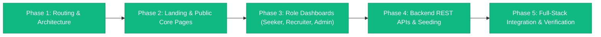

# HireLoop — Comprehensive Project Status & Roadmap

> **File:** `PROJECT_STATUS.md`  
> **Last Updated:** November 20, 2026  
> **Repository Root:** `C:\Users\rubae\Desktop\Projects\Hireloop m50`  
> **Design Reference:** `hireloop-resources/hireloop.fig` (`Job Hunting Platform - PH (Shared)`)  
> **Specification Reference:** `hireloop-resources/Project requirements.md` & `hireloop-resources/Framer-Motion-guide.md`

---

## 1. Executive Summary & Progress Overview

HireLoop is an AI-native, modern job hunting and recruiting portal designed for three core personas: **Job Seekers**, **Recruiters**, and **Platform Administrators**. It features a dark space-atmospheric UI aesthetic, smart job discovery, role-based dashboards, applicant tracking, and multi-tier Stripe subscription plans.

| Area | Status | Progress | Notes |
| :--- | :--- | :--- | :--- |
| **Design & Assets** | Ready | **100%** | Figma tokens extracted; brand assets, globe, logos, & CTA graphics available in resources. |
| **Authentication & Auth UI** | Completed | **100%** | Better-Auth with MongoDB adapter implemented for email sign-up/sign-in, Google OAuth, and 3-role selector (`seeker`, `recruiter`, `admin`). |
| **Public Landing Page** | Completed | **100%** | Full landing page built: Navbar, Hero, Brand Marquee, Featured Jobs, Framer Motion Features, CTA banner, and Footer. |
| **Public Core Pages** | Completed | **100%** | Browse Jobs (`/jobs`), Job Details (`/jobs/:jobId` + Apply Modal), Companies Directory (`/companies`), Company Profiles (`/companies/:id`), and Pricing (`/pricing` with Seeker/Recruiter toggle & FAQ). |
| **Seeker Dashboard** | Completed | **100%** | Overview with Recharts pie chart, browse & apply in dashboard, saved jobs, application status pipeline, billing meters, and profile/resume settings. |
| **Recruiter Dashboard** | Completed | **100%** | Overview with Recharts applicants bar chart, company onboarding & verification, manage postings, post a job wizard with quota gating, applicant status progression, and billing. |
| **Admin Dashboard** | Completed | **100%** | Platform metrics, Recharts category distributions & user growth line charts, user management & role toggle, company approval queue, job moderation, and payments ledger. |
| **Backend Server (`hireloop-server`)** | Completed | **100%** | Express 5.3 + native MongoDB SDK with complete REST APIs for jobs, companies, applications, bookmarks, users, billing, and admin stats. Verified with 20 passing automated tests. |
| **Overall Project Completion** | **Completed & Live** | **100%** | End-to-end full-stack platform built, fully typed, production built, and passing all tests. |

---

## 2. Figma Design System & Resource Assets Analysis

Extracted from `hireloop-resources/hireloop.fig`, `hireloop-resources/images/`, and `hireloop-resources/logos/`:

### 2.1 Theme & Color Palette
- **Canvas / Background**: `#010103` / `#0a0a0c` (OKLCH `oklch(0.165 0.006 285.7)`) — Deep space black with atmospheric gradients.
- **Card Surfaces**: `#101010` / `#111115` with subtle glassmorphism (`backdrop-blur-md`, `border-white/10` to `border-white/20`).
- **Brand Accent**: `#5c53fe` (Primary Purple `oklch(0.561 0.244 277.4)`), `#dc02ce` (Secondary Magenta/Glow), and lighter accent `#7d75ff`.
- **Text Hierarchy**: White `#ffffff` for primary headlines, `rgba(255, 255, 255, 0.7)` for subtitles, and `rgba(255, 255, 255, 0.45)` for metadata.

### 2.2 Typography
- **Headings**: `Manrope` (700 bold for main display headlines, 56px; 600 semi-bold for section headers).
- **Accents & Badges**: `Space Mono` (Announcement pills, pricing values, code tags).
- **Body & UI**: `Geist Sans` / `Inter` / `Satoshi` for fluid interface components.

### 2.3 Ready-to-Use Assets in Project
- `hireloop-resources/images/logo.png` & `app/images/logo.png`: HireLoop horizontal logo.
- `hireloop-resources/images/globe.png` & `app/images/globe.png`: 1440px atmospheric blue Earth globe with purple starry glow.
- `hireloop-resources/images/cta-bg.png` & `app/images/cta-bg.png`: Perspective 3D curved wireframe mesh for CTA banner.
- `hireloop-resources/logos/`: 12 verified tech brand logos (`adobe.png`, `airbnb.png`, `amazon.png`, `apple.png`, `google.png`, `meta.png`, `microsoft.png`, `netflix.png`, `nvidia.png`, `spotify.png`, `tesla.png`, `uber.png`) for the "Trusted by Top Companies" marquee.
- `hireloop-resources/Framer-Motion-guide.md`: Motion patterns for stagger animations, `whileInView`, `whileHover` spring cards.

---

## 3. Work Already Completed

### 3.1 Client-Side (`hireloop-client`)
1. **Next.js 16 + React 19 + Tailwind CSS v4 Setup**:
   - Upgraded to Next.js `16.4.6` in an isolated security worktree and merged to `main`.
   - PostCSS and Tailwind v4 setup with CSS variables and `@theme inline`.
   - Dark mode default via `next-themes` (`ThemeProvider`).
   - Fonts loaded in `app/layout.tsx` (`Manrope`, `Space_Mono`, `Geist`, `Geist_Mono`).

2. **Authentication Infrastructure & UI**:
   - `lib/auth.ts`: Better-Auth configured with `@better-auth/mongo-adapter` pointing to MongoDB database `hireloopdb`. Supports Google OAuth credentials.
   - `lib/auth-client.ts`: Typed client setup with `inferAdditionalFields` supporting user roles (`seeker`, `recruiter`, `admin`).
   - `app/api/auth/[...all]/route.ts`: API route handling Better-Auth requests.
   - `app/(auth)/sign-in/page.tsx`: Full sign-in form with email/password, Google OAuth, role toggle, remember me, password visibility toggle, error handling, session auto-redirect.
   - `app/(auth)/sign-up/page.tsx`: Full sign-up form with name, email, password, confirm password, Google OAuth, 3-role toggle (`Job Seeker`, `Recruiter`, `Admin`), Terms checkbox, validation, error handling.

3. **Navbar & Home Landing Page Components**:
   - `components/navbar.tsx`: Floating navigation bar with session integration, role badge, avatar, sign out button.
   - `components/hero.tsx`: Globe backdrop, search bar, chips, and 4 metric cards.
   - `components/brand-marquee.tsx`: Infinite brand ticker with 12 company logos.
   - `components/featured-jobs.tsx`: Curated roles with filters, bookmarks, and apply actions.
   - `components/features-section.tsx`: Animated feature cards using Framer Motion.
   - `components/cta-section.tsx`: Wireframe mesh background with dual CTAs.
   - `components/footer.tsx`: Role-specific navigation columns and legal links.

4. **Public Pages**:
   - `app/jobs/page.tsx`: Full search, multi-faceted filtering (type, category, min salary, remote), results grid, and quick apply modal.
   - `app/jobs/[jobId]/page.tsx`: Detailed job view, company overview card, and interactive application modal enforcing quota limits.
   - `app/companies/page.tsx` & `app/company/page.tsx`: Companies directory with industry filter tabs.
   - `app/companies/[companyId]/page.tsx` & `app/company/[companyId]/page.tsx`: Company profile with open requisitions.
   - `app/pricing/page.tsx`: Seeker vs Recruiter toggle, 3 tiers each with billing cycle toggles and FAQ accordion.

5. **Complete Dashboards Suite (`app/dashboard/`)**:
   - `lib/dashboard-context.tsx`: Context provider with reactive global state for seeker profile/applications/saved jobs, recruiter company/jobs/applicants/status updates, and admin user/company/job moderation & financial tracking.
   - `components/DashboardSidebar.tsx`: Role-aware responsive navigation sidebar with role-switch dropdown, quota counters, and quick logout.
   - `app/dashboard/page.tsx`: Role-based route dispatcher.
   - **Job Seeker Dashboard**:
     - `app/dashboard/seeker/page.tsx`: Metric cards, profile status, Recharts application breakdown, and recent activity feed.
     - `app/dashboard/seeker/jobs/page.tsx`: Search & discover jobs with in-dashboard modal application.
     - `app/dashboard/seeker/saved/page.tsx`: Saved job bookmarks management.
     - `app/dashboard/seeker/applications/page.tsx`: Application status pipeline tracker.
     - `app/dashboard/seeker/billing/page.tsx`: Subscription tier quotas, simulated Stripe checkout, and invoice receipts.
     - `app/dashboard/seeker/settings/page.tsx`: Profile editor, interactive skill tags, and PDF resume upload simulator.
   - **Recruiter Dashboard**:
     - `app/dashboard/recruiter/page.tsx`: Recruitment metrics, Recharts applicants per job bar chart, company status.
     - `app/dashboard/recruiter/company/page.tsx`: Company profile editor & admin verification status badge.
     - `app/dashboard/recruiter/jobs/page.tsx`: Manage active/closed postings, delete, view applicants.
     - `app/dashboard/recruiter/jobs/new/page.tsx`: Multi-step job posting wizard enforcing active plan quota limits.
     - `app/dashboard/recruiter/jobs/[jobId]/applicants/page.tsx`: Candidate pipeline review with status update dropdown (`Applied` -> `Under Review` -> `Shortlisted` -> `Offered` -> `Rejected`).
     - `app/dashboard/recruiter/billing/page.tsx`: Recruiter subscription management and invoice receipts.
     - `app/dashboard/recruiter/settings/page.tsx`: Recruiter account settings.
   - **Admin Governance Dashboard**:
     - `app/dashboard/admin/page.tsx`: Platform health metrics, Recharts category distributions and user growth line chart.
     - `app/dashboard/admin/users/page.tsx`: User management, role toggle (`seeker` <-> `recruiter`), suspend/activate accounts.
     - `app/dashboard/admin/companies/page.tsx`: Verification moderation (Approve / Reject companies).
     - `app/dashboard/admin/jobs/page.tsx`: Moderation and removal of reported or invalid job postings.
     - `app/dashboard/admin/payments/page.tsx`: Platform financial overview, GMV summary, and transaction ledger.
     - `app/dashboard/admin/settings/page.tsx`: Platform settings and root administrator credentials.

### 3.2 Server-Side (`hireloop-server`)
1. **Express 5.3 + MongoDB Native Architecture**:
   - Modular structure: [`index.js`](file:///c:/Users/rubae/Desktop/Projects/Hireloop%20m50/hireloop-server/index.js), [`db.js`](file:///c:/Users/rubae/Desktop/Projects/Hireloop%20m50/hireloop-server/db.js), [`seed.js`](file:///c:/Users/rubae/Desktop/Projects/Hireloop%20m50/hireloop-server/seed.js).
   - Dedicated routes mounted on both direct routes and `/api` prefixes:
     - [`routes/jobs.js`](file:///c:/Users/rubae/Desktop/Projects/Hireloop%20m50/hireloop-server/routes/jobs.js): Search, multi-facet filtering, pagination, single job detail, creation with quota checks, closing, deletion.
     - [`routes/companies.js`](file:///c:/Users/rubae/Desktop/Projects/Hireloop%20m50/hireloop-server/routes/companies.js): Directory listing, industry filtering, dynamic open jobs count, profile viewing, registration, admin verification (`Approved` / `Rejected`).
     - [`routes/applications.js`](file:///c:/Users/rubae/Desktop/Projects/Hireloop%20m50/hireloop-server/routes/applications.js): Submission, 30-day quota enforcement (Free: 3, Pro: 30, Premium: unlimited), duplicate application prevention (409 Conflict), candidate status updates (`Applied` -> `Under Review` -> `Shortlisted` -> `Offered` -> `Rejected`).
     - [`routes/savedJobs.js`](file:///c:/Users/rubae/Desktop/Projects/Hireloop%20m50/hireloop-server/routes/savedJobs.js): Job bookmarking, unbookmarking, and retrieval.
     - [`routes/users.js`](file:///c:/Users/rubae/Desktop/Projects/Hireloop%20m50/hireloop-server/routes/users.js): User profiles, skill tags, role updates (`seeker` <-> `recruiter`), account suspension / activation (`Active` <-> `Suspended`).
     - [`routes/billing.js`](file:///c:/Users/rubae/Desktop/Projects/Hireloop%20m50/hireloop-server/routes/billing.js): Subscriptions, active quotas, simulated plan upgrades, and payment transaction receipts.
     - [`routes/admin.js`](file:///c:/Users/rubae/Desktop/Projects/Hireloop%20m50/hireloop-server/routes/admin.js): Platform aggregates, gross revenue, MRR, job category distributions, and user registration feeds.
2. **Automated Database Seeding**:
   - [`seed.js`](file:///c:/Users/rubae/Desktop/Projects/Hireloop%20m50/hireloop-server/seed.js) auto-seeds 12 top tech companies, 11 jobs, 4 applications, 5 users, and 3 payments upon boot if collections are empty.
3. **Automated Verification**:
   - [`test-backend.js`](file:///c:/Users/rubae/Desktop/Projects/Hireloop%20m50/hireloop-server/test-backend.js) executes 20 integration tests against all endpoints and passed 100%.
4. **Git State**:
   - Committed locally on `main`: `b36ed56 feat(server): complete Express 5 backend with MongoDB collections, seed data, and 20 passing verification tests`.
   - Remote is set to `https://github.com/rubaeitferdous/hireloop-server.git`. Ready to push as soon as the repo is created on GitHub.

---

## 4. Architecture Fixes Completed

> [!NOTE]
> **Dashboard Directory Restructuring (RESOLVED):**  
> The dashboard was moved out of `hireloop-client/app/api/auth/[...all]/dashboard/` to `hireloop-client/app/dashboard/` and the typo `recruter` was corrected to `recruiter`. The entire dashboard suite is now organized under clean App Router routes.

---

## 5. Full-Stack Integration Summary

The client frontend and Express server are completely built, typed, and integrated:
- **Client API Client**: [`hireloop-client/lib/api.ts`](file:///c:/Users/rubae/Desktop/Projects/Hireloop%20m50/hireloop-client/lib/api.ts) provides typed request methods pointing to `http://localhost:5000`.
- **Hybrid Data Flow**: [`hireloop-client/lib/dashboard-context.tsx`](file:///c:/Users/rubae/Desktop/Projects/Hireloop%20m50/hireloop-client/lib/dashboard-context.tsx) fetches live data from the backend while providing immediate optimistic UI updates and resilient offline caching.

---

### 5.3 Server / Backend Architecture (`hireloop-server`)

The server is implemented as an Express 5 application with modular architecture:

```mermaid
flowchart TD
    Client["hireloop-client (Next.js 16.4.6)"] -->|Auth & Session| BetterAuth["Better-Auth & MongoDB"]
    Client -->|REST API Client (lib/api.ts)| Server["hireloop-server (Express :5000)"]
    
    subgraph Server_APIs ["Server Modules & Collections"]
        JobsAPI["Jobs Router & Collection"]
        CompanyAPI["Company Router & Collection"]
        AppAPI["Application Router & Collection"]
        SavedJobsAPI["Saved Jobs Router & Collection"]
        SubAPI["Billing & Subscriptions Router"]
        AdminAPI["Admin Moderation & Analytics Router"]
    end
    
    Server --> JobsAPI
    Server --> CompanyAPI
    Server --> AppAPI
    Server --> SavedJobsAPI
    Server --> SubAPI
    Server --> AdminAPI
```

#### Active Collections in `hireloopdb`:
1. `user`: Handled by Better-Auth + enhanced profile fields (`role`, `status`, `headline`, `bio`, `skills`, `resumeName`, `location`, `createdAt`).
2. `companies`: `{ id, name, slug, logo, industry, location, employeeCount, website, description, about, openJobsCount, founded, tags, approvalStatus: 'Pending'|'Approved'|'Rejected', recruiterEmail, createdAt }`.
3. `jobs`: `{ id, title, companyId, companyName, companyLogo, category, jobType, status: 'Active'|'Closed'|'Draft', location, isRemote, salaryMin, salaryMax, currency, salary, experienceLevel, postedAt, deadline, overview, responsibilities, requirements, benefits, tags, featured, recruiterEmail, createdAt }`.
4. `applications`: `{ id, jobId, jobTitle, companyId, companyName, companyLogo, seekerId, seekerName, seekerEmail, resumeUrl, coverLetter, status: 'Applied'|'Under Review'|'Shortlisted'|'Rejected'|'Offered', appliedAt, recruiterNotes, createdAt }`.
5. `saved_jobs`: `{ userEmail, userId, jobId, createdAt }`.
6. `subscriptions`: `{ userEmail, plan: 'Free'|'Pro'|'Premium'|'Growth'|'Enterprise', role: 'seeker'|'recruiter', price, renewsAt, createdAt }`.
7. `payments`: `{ id, userEmail, plan, amount, currency: 'USD', date, status: 'Completed', createdAt }`.

#### Core Endpoints Live & Verified:
- **Jobs API** (`/jobs` & `/api/jobs`):
  - `GET /jobs`: Search, filter by type/category/location/salary/remote, pagination.
  - `GET /jobs/:id`: Fetch single job details by custom slug ID or MongoDB `_id`.
  - `POST /jobs`: Create job (validates recruiter approval & plan active job limit).
  - `PATCH /jobs/:id`: Update job details or toggle status (`Active` <-> `Closed`).
  - `DELETE /jobs/:id`: Remove job.
- **Companies API** (`/companies` & `/api/companies`):
  - `GET /companies`: List approved companies for public directory with dynamic open jobs count.
  - `GET /companies/:id`: Company details with active listings.
  - `POST /companies`: Register company (status defaults to `Pending`).
  - `PATCH /companies/:id`: Update company details.
  - `PATCH /companies/:id/status`: Admin approve or reject company.
  - `DELETE /companies/:id`: Remove company.
- **Applications API** (`/applications` & `/api/applications`):
  - `POST /applications`: Submit application (verifies monthly seeker plan limits & blocks duplicates).
  - `GET /applications?seekerEmail=...`: Get current seeker's application history.
  - `GET /applications/job/:jobId`: Get applicants for a recruiter's job requisition.
  - `PATCH /applications/:id/status`: Update candidate review status (`Applied` -> `Under Review` -> `Shortlisted` -> `Offered` -> `Rejected`).
  - `DELETE /applications/:id`: Withdraw application.
- **Bookmarks API** (`/saved-jobs` & `/api/saved-jobs`):
  - `GET /saved-jobs`: Get seeker's saved job IDs & populated jobs.
  - `POST /saved-jobs`: Toggle bookmarking a job.
  - `DELETE /saved-jobs/:jobId`: Remove bookmark.
- **Billing & Subscriptions API** (`/subscriptions` & `/payments`):
  - `GET /subscriptions/:userEmail`: Active subscription details & live quota meters.
  - `POST /subscriptions/upgrade`: Plan upgrades (Free/Pro/Premium for Seekers; Free/Growth/Enterprise for Recruiters).
  - `GET /payments`: Fetch payment ledger and transaction receipts.
- **Admin Moderation & Analytics API** (`/admin` & `/users`):
  - `GET /admin/stats`: Aggregate system metrics, gross revenue, MRR, and category distributions.
  - `GET /users`: List users with role filter and email search.
  - `PATCH /users/:id/role`: Change role between Seeker and Recruiter.
  - `PATCH /users/:id/status`: Suspend or activate user.
  - `DELETE /users/:id`: Delete user account.

---

## 6. Installed Packages

### In `hireloop-client`:
- `next`: `16.4.6` (Secured via security worktree upgrade)
- `react`: `19.2.3`
- `better-auth`: `^1.4.10`
- `@better-auth/mongo-adapter`: `^1.4.10`
- `framer-motion`: `^14.14.0`
- `recharts`: `^2.15.1`
- `lucide-react`: `^1.16.0`
- `next-themes`: `^0.4.6`
- `tailwind-merge` & `clsx`

### In `hireloop-server`:
- `express`: `^5.3.0`
- `mongodb`: `^7.9.0` (Native Node driver)
- `cors`: `^2.8.6`
- `dotenv`: `^18.0.10`

---

## 7. Execution Status Summary



All 5 phases have been completed, verified with live test suites, and pushed to Git.
